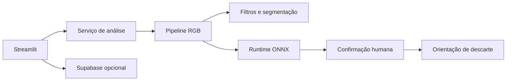

# Recicla SP · EcoScan

[](https://github.com/Gabrielhamad/ecoscan/actions/workflows/quality.yml)
[](runtime.txt)
[](https://ecoscan-gabrielhamad.streamlit.app)

Aplicação de educação ambiental que analisa uma foto, sugere o material e orienta o descarte. O produto combina processamento de imagens, reconhecimento assistido, mapa de coleta, conteúdo educativo, missões e uma área de gestão.

**Aplicação:** https://ecoscan-gabrielhamad.streamlit.app

## Estado da entrega

O fluxo web, a autenticação, o processamento de imagens e o reconhecedor ONNX estão implementados e cobertos por testes automatizados. O reconhecimento permanece **assistido**: a hipótese exibida exige confirmação humana antes de orientar descarte ou pontuar uma missão.

| Área | Estado | Observação |
| --- | --- | --- |
| Interface pública | Pronta para piloto | Câmera, upload, mapa, descarte e educação |
| Gestão | Pronta para piloto controlado | Revisões, campanhas, protocolos e indicadores |
| Reconhecimento | Assistido | Uma única release ONNX; confirmação obrigatória |
| Persistência | Condicional | Requer Supabase e migrações configuradas |
| Operação pública | Em validação | Falta aceite real em celular, contas e banco de produção |

Os bloqueios para entrega estão em [Avaliação técnica](docs/avaliacao_tecnica.md) e no [Roadmap de entrega](docs/roadmap_entrega.md).

## Escopo do reconhecimento

O modelo trabalha com seis materiais:

- plástico, com prioridade para garrafas PET e recipientes rígidos;
- metal, com prioridade para latas de bebida e conserva;
- vidro, com prioridade para garrafas e potes;
- papel e papelão;
- pilhas domésticas;
- pequenos eletrônicos.

Metal, plástico e vidro são as classes prioritárias do piloto. Alimentos, orgânicos, medicamentos e óleo não são identificados automaticamente.

## Arquitetura atual



O runtime aceita somente `semantic_onnx_assisted`. A configuração aponta para `models/semantic-v1/semantic.json`; releases remotas precisam usar o mesmo encoder, classes, contrato de preparação e hashes. Os classificadores históricos e seus fallbacks foram removidos do produto atual.

Detalhes: [Arquitetura](docs/arquitetura_atual.md) e [Modelo de reconhecimento](docs/modelo_reconhecimento.md).

## Execução local

Requer Python 3.12.

```bash
git clone https://github.com/Gabrielhamad/ecoscan.git
cd ecoscan
python -m venv .venv
source .venv/bin/activate  # Windows: .venv\Scripts\activate
python -m pip install --upgrade pip
python -m pip install -e '.[dev]'
streamlit run streamlit_app.py
```

A aplicação abre em `http://localhost:8501`.

## Configuração de serviços

Copie `.streamlit/secrets.example.toml` para `.streamlit/secrets.toml` e preencha somente no ambiente local ou no painel do Streamlit Cloud. Nunca publique chaves, tokens, fotos privadas ou dados de participantes.

O modo sem banco continua útil para demonstração pública. Cadastro, protocolos persistentes, campanhas compartilhadas e treinamento revisado exigem Supabase configurado conforme [Banco](docs/banco_gratuito.md) e [Autenticação](docs/autenticacao.md).

## Qualidade

```bash
python -m ruff check src scripts tests
python -m pytest -q
python -m pip check
python scripts/run_acceptance_checks.py --diagnostic
```

A CI executa testes, lint crítico, verificação de dependências, diagnóstico e validação das migrações PostgreSQL.

## Estrutura

```text
config/             configuração funcional e conteúdo ambiental
models/semantic-v1 release ativa, licença e hashes
src/ecoscan/        aplicação, domínio, processamento e serviços
scripts/            operação, dataset e diagnóstico atuais
tests/              regressões automatizadas
migrations/         banco compartilhado e políticas de acesso
docs/               documentação atual da entrega
```

## Documentação

- [Índice da documentação](docs/README.md)
- [Arquitetura atual](docs/arquitetura_atual.md)
- [Modelo de reconhecimento](docs/modelo_reconhecimento.md)
- [Operação da gestão](docs/operacao_secretaria.md)
- [Roadmap de entrega](docs/roadmap_entrega.md)
- [Avaliação técnica](docs/avaliacao_tecnica.md)
- [Como contribuir](CONTRIBUTING.md)
- [Catálogo de scripts](scripts/README.md)

O histórico de experimentos e métodos substituídos continua disponível no Git. O branch principal documenta apenas o produto atual.
