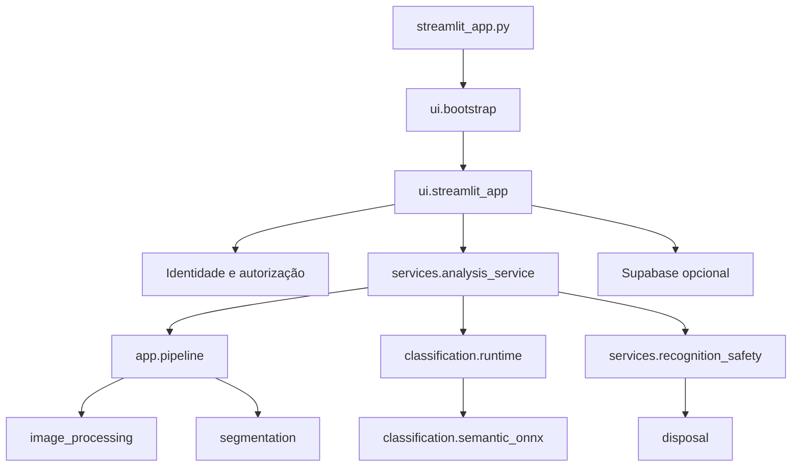

# Arquitetura atual

## Objetivo

O Recicla SP separa interface, processamento, reconhecimento e orientação ambiental. O reconhecedor sugere uma classe; regras de produto decidem o que pode ser exibido ou persistido.

## Responsabilidades

| Camada | Responsabilidade | Não deve fazer |
| --- | --- | --- |
| `ui/` | Montar páginas, estado de sessão e interação | Treinar ou escolher modelos por extensão |
| `services/` | Orquestrar casos de uso, persistência e políticas | Implementar filtros ou redes neurais |
| `app/pipeline.py` | Executar preparação, filtro, segmentação e evidências | Definir autorização ou descarte |
| `classification/` | Carregar a release atual e produzir probabilidades | Confirmar material ou destino |
| `disposal/` | Orientação, impactos e pontos de coleta | Alterar a previsão |
| `training/` | Ajustar a cabeça supervisionada com dados revisados | Publicar sem gates e proveniência |

## Reconhecimento

Existe um único motor de produção: `semantic_onnx_assisted`. O arquivo `config/settings.json` declara o motor e o caminho do metadado. `classification.runtime` rejeita qualquer outro formato; não há fallback silencioso para classificadores históricos.

O encoder ONNX fica congelado. A cabeça supervisionada pode ser atualizada por uma fila privada, desde que a release preserve:

- as seis classes e a classe `unknown`;
- o hash do encoder;
- o contrato `rgb-preserved-v2`;
- os hashes da cabeça e dos metadados;
- as revisões consentidas usadas no ajuste.

## Inicialização

A abertura pública carrega somente configuração, identidade e recursos estáticos. NumPy, Pillow, ONNX Runtime, governança e ferramentas administrativas entram apenas quando a página ou ação correspondente é usada. O banco remoto possui timeouts limitados e não bloqueia a primeira página.

## Persistência

Sem Supabase, o app opera como demonstração e evita prometer persistência. Com Supabase ativado, autenticação, contribuições, campanhas e relatos usam tabelas e Storage protegidos pelas migrações versionadas.

## Limites atuais

- `ui/streamlit_app.py` ainda concentra a composição de várias páginas.
- O encoder versionado ocupa a maior parte do repositório.
- A confirmação humana é obrigatória; o desempenho ainda não permite orientação automática.
- O modo de câmera ao vivo usa serviço separado e não acompanha o deploy gratuito do Streamlit.

Esses pontos estão priorizados em [Avaliação técnica](avaliacao_tecnica.md) e [Roadmap](roadmap_entrega.md).
