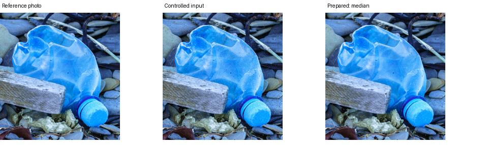

# Preparacao antes do reconhecimento e convolucao

## Etapa executada

Foi medido o preparo adaptativo em 23 fotos reais revisadas, sob quatro
condicoes: sem corrupcao adicional, ruido gaussiano, ruido impulsivo e reducao
controlada de contraste. Sao 92 pares por configuracao, com sementes fixas
derivadas do hash da imagem. As fotos de referencia podem conter ruido natural.

SSIM compara cada resultado com a foto de referencia, antes da corrupcao
artificial. Melhorar SSIM neste ensaio nao comprova aumento de acuracia nem
recuperacao de detalhes perdidos pela camera.

| Condicao | Padrao: melhora/piora | Limiar experimental 8: melhora/piora |
| --- | --- | --- |
| Sem corrupcao adicional | 0 / 4 | 0 / 0 |
| Ruido gaussiano | 21 / 1 | 17 / 1 |
| Ruido impulsivo | 23 / 0 | 23 / 0 |
| Contraste reduzido | 16 / 0 | 16 / 0 |

Cada linha tem 23 fotos; os casos restantes nao mudaram. O limiar experimental
preserva as fotos originais desta amostra, mas deixa de corrigir alguns casos
ruidosos. Por isso nao substituiu automaticamente o perfil publicado. Esta
amostra foi usada para comparar parametros, nao e um teste independente.

Resultados completos: [padrao](preparation_evidence/default.json) e
[limiar experimental](preparation_evidence/sigma8.json).



## Tecnicas e finalidade

- EXIF e composicao RGB: orientar corretamente, preservar transparencia sobre
  fundo definido e manter cores. Aplicar a orientacao antes de recortes anotados.
- Redimensionamento proporcional e letterbox: preservar a forma do objeto;
  preparar a entrada 224x224 sem esticar garrafas ou latas.
- Mediana seletiva: substituir pixels diagnosticados como impulsos isolados,
  mantendo os demais pixels intactos.
- Bilateral: suavizar variacoes locais semelhantes, com protecao de bordas.
- Gaussiano: convolucao espacial para suavizacao leve quando o diagnostico e
  os limites de preservacao permitem. Nao e uma rede neural.
- CLAHE: ajuste local de contraste no canal de luminancia, com intensidade
  limitada. Nao usar como recuperacao garantida de sombras ou luz estourada.
- Otsu e GrabCut: produzir mascaras de inspeção; morfologia trata pequenos
  elementos dessas mascaras. Nao apagam o fundo da entrada do classificador.
- Sobel/Canny: evidenciar transicoes e contornos na analise; nao substituem
  a foto RGB fornecida ao reconhecimento.

O perfil continua podendo escolher nenhuma alteracao. Foto desfocada precisa
de nova captura: suavizacao nao recupera informacao que a camera nao registrou.

## Evidencia de convolucao

O filtro gaussiano agora registra a matriz de pesos usada, sigma, dimensao e
tratamento de borda `reflect_101`. A soma dos pesos e 1. Os canais RGB sao
processados separadamente. O teste reconstroi a operacao com `filter2D` e
compara os pixels com `GaussianBlur`, admitindo arredondamento de ate 1 nivel.

Quando gaussiano e escolhido, a area tecnica do aplicativo mostra a matriz.
Mediana, bilateral e CLAHE nao devem ser descritos como convolucoes lineares.
A CNN MobileNetV2 usa filtros aprendidos no treinamento; esses pesos sao
distintos do kernel gaussiano de preparacao.

## Treinamento convolucional

O comando `fine_tune_candidate.py` agora aceita as decisoes de revisao e
verifica o numero de exemplos realmente elegiveis antes de preparar tensores
ou treinar. Exemplos excluidos, validacao e teste nao completam o minimo.
O minimo padrao de 20 por material e apenas uma barreira operacional; nao e
uma meta suficiente de diversidade nem uma garantia estatistica.

A tentativa com a revisao do escopo foi bloqueada corretamente: pilhas tinham
2 exemplos e eletronicos 1. Os outros materiais tinham 84 plasticos, 79 papeis,
82 metais e 87 vidros elegiveis. Os 23 novos recortes estao em um lote separado;
eles nao suprem as duas classes deficientes. Nenhum novo treino foi concluido.

```powershell
python scripts/fine_tune_candidate.py --source ../ecoscan/data/curated --reference-run reports/training_curated_20261017 --review-index docs/datasets/taco_v1/legacy_review_index.csv --review-decisions docs/curation_scope_v1.json --output reports/nova_rodada_cnn --epochs 8
```

O proximo ciclo precisa integrar os novos exemplos mantendo grupos e exclusoes,
ampliar AA/AAA e os eletronicos definidos e comparar o preparo sem filtro e
adaptativo na validacao. So depois avaliar no teste independente e verificar
recursos da hospedagem antes da publicacao.

## Reproduzir o ensaio de preparacao

```powershell
python scripts/benchmark_image_preparation.py --source data/curated/objects_v1_taco_reviewed --manifest data/curated/objects_v1_taco_reviewed/manifest.json --output reports/novo_ensaio
```

Adicionar `--min-noise-sigma 8` para repetir a comparacao conservadora em outro
diretorio. O programa salva os pares visuais, decisoes, hashes e metricas por foto.
