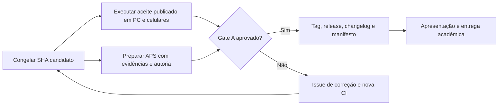

# Roadmap de entrega e evolução — EcoScan

**Revisão:** 07/11/2026 · **baseline:** `04c1a34bcb22026e03b2a3b2396856c2994746e1`  
**Objetivo:** encerrar a APS com um produto tecnicamente demonstrável, documentação rastreável e aprovação verificável.  
**Plano emergencial para entrega em 11/11/2026:** [Validação técnica da APS em quatro dias](plano_validacao_aps_4_dias.md).

**Fonte de acompanhamento:** [backlog GitHub Issues](https://github.com/Gabrielhamad/ecoscan/issues?q=is%3Aissue+is%3Aopen), [parecer de prontidão](parecer_prontidao_2026-11-07.md) e [plano de gestão](gestao_projeto.md).

## Decisão de escopo

O projeto **não precisa de novo ciclo amplo de refatoração nem de um reconhecedor perfeito** para ser apresentado academicamente. Já possui arquitetura modular, classificação assistida com confirmação de material, regras ambientais, gestão, testes e documentação.

O que falta para **declarar o pacote final concluído** são evidências e rastreabilidade: teste da versão publicada em aparelhos reais, identificação/autoria e pacote final da APS, e release/tag da versão apresentada. O reconhecimento sem assistência e a operação institucional são marcos futuros separados.

## 1. Fases e marcos

| Marco | Entrega verificável | Estado em 07/11/2026 | Evidência ou próxima ação |
| --- | --- | --- | --- |
| M0 — Escopo e arquitetura | Módulos de UI, serviços, domínio, processamento, classificação e banco documentados | **Concluído tecnicamente** | `docs/arquitetura_interface.md` e `docs/arquitetura_atual.md` |
| M1 — Qualidade de código | Testes, Ruff, dependências e migrações PostgreSQL na CI do commit de referência | **Concluído na CI** | [Run 42061103008](https://github.com/Gabrielhamad/ecoscan/actions/runs/42061103008): 496 testes, 108 subtestes, 7 avisos, CI verde |
| M2 — Aceite do aplicativo publicado | Teste de visitante e usuário, computador/Android/iPhone, navegação, autenticação e gestão no mesmo SHA da release | **Pendente no SHA atual** | [Issue #10](https://github.com/Gabrielhamad/ecoscan/issues/10) |
| M3 — Pacote acadêmico | Relatório da APS, autores reais, requisitos, diagramas, imagens de código, testes e banco | **Pendente de revisão final** | [Issue #12](https://github.com/Gabrielhamad/ecoscan/issues/12) |
| M4 — Release candidata e handoff | Changelog, tag/release, manifesto de versões, procedimento de retorno, decisão assinada/atribuída | **Pendente** | [Issue #11](https://github.com/Gabrielhamad/ecoscan/issues/11) |
| M5 — Continuidade operacional | Backup/restauração em ambiente isolado, indisponibilidade, identidade e Storage | **Pendente para operação institucional** | [Issue #13](https://github.com/Gabrielhamad/ecoscan/issues/13) |
| M6 — Reconhecimento de campo | Teste independente por objeto/sessão, métricas por classe e limites | **Pendente para alegações de desempenho em campo** | [Issue #14](https://github.com/Gabrielhamad/ecoscan/issues/14) |
| M7 — Maturidade de engenharia | Branch protegida, revisão, licença, build reproduzível e observabilidade | **Evolução planejada** | [Issues #15](https://github.com/Gabrielhamad/ecoscan/issues/15), [#16](https://github.com/Gabrielhamad/ecoscan/issues/16), [#17](https://github.com/Gabrielhamad/ecoscan/issues/17) |

**Critério de fase:** não marcar um marco como concluído apenas por existir documento ou teste local; cada linha requer um resultado, um SHA, a pessoa executora e evidência registrada. O teste público histórico de 04/11/2026 refere-se ao commit `16344df` e não aprova automaticamente o commit de referência atual.

## 2. Backlog priorizado com dependências

| Ordem de execução | Prioridade | Pacote de trabalho | Papel que deverá ser designado | Dependência | Definição de aceite |
| --- | --- | --- | --- | --- | --- |
| 1 | **P0** | [#10 — Aceite no app publicado](https://github.com/Gabrielhamad/ecoscan/issues/10) | QA/aceite | Fixar candidato à entrega | Dispositivos + identidades e fluxos críticos aprovados no SHA publicado |
| 2 | **P0** | [#12 — Material da APS](https://github.com/Gabrielhamad/ecoscan/issues/12) | Coordenação/documentação | Evidências da versão candidata e manual da instituição | Autoria real, relatório/figuras/referências e correspondência entre requisitos e código |
| 3 | **P0** | [#11 — Tag, changelog e manifesto](https://github.com/Gabrielhamad/ecoscan/issues/11) | Mantenedor/release | Itens 1 e 2 aprovados | Tag/release apontando para CI verde e pacote comprovado; plano de retorno revisado |
| 4 | **P1** | [#15 — Governança Git e licença](https://github.com/Gabrielhamad/ecoscan/issues/15) | Mantenedor | Permissões GitHub e decisão de licença | Políticas aplicadas/verificadas, limitações documentadas, revisão rastreável |
| 5 | **P1** | [#13 — Recuperação e Supabase](https://github.com/Gabrielhamad/ecoscan/issues/13) | Infra/QA | Ambiente isolado autorizado | Restauro verificado de dados + Storage + identidade + teste de indisponibilidade |
| 6 | **P1** | [#14 — Modelo com fotos novas](https://github.com/Gabrielhamad/ecoscan/issues/14) | Dados/QA | Fotos com proveniência e splits congelados | Relatório reproduzível e independente de precisão/recall/F1/rejeição |
| 7 | **P2** | [#16 — Dependências e artefato](https://github.com/Gabrielhamad/ecoscan/issues/16) | Desenvolvimento/DevOps | Avaliar restrições do deploy | Build previsível e encoder versionado com hash após validação |
| 8 | **P2** | [#17 — Telemetria](https://github.com/Gabrielhamad/ecoscan/issues/17) | Operação | Regras de privacidade e custo | Eventos técnicos sem dados pessoais, runbook de triagem validado |

P0, P1 e P2 são **prioridades de execução, não estimativas de prazo**. Definir datas reais no quadro GitHub somente após o grupo informar o calendário acadêmico, a disponibilidade dos integrantes e a data-limite de entrega.

## 3. Caminho crítico até a APS

**Mudança tardia de código:** se houver correção depois do aceite, o SHA muda. Repetir CI e, ao menos, os cenários impactados antes de criar a release. Não usar um relatório de execução antigo como evidência do código novo.

## 4. Critérios de liberação (release gates)

### Gate A — Entrega acadêmica

| Verificação obrigatória | Estado |
| --- | --- |
| Código no GitHub, instalação e arquitetura documentadas | **Aprovado tecnicamente** |
| Qualidade automatizada no SHA candidato | **Aprovado no commit de referência** |
| Ausência de defeito crítico de segurança conhecido no fluxo demonstrado | **Exige triagem/aceite no deploy atual** |
| Smoke de visitante/participante/gestor em aparelhos reais no SHA publicado | **Pendente** |
| Documento APS e autoria conferidos contra o manual institucional | **Pendente** |
| Release/tag, changelog, SHA do modelo, manifesto de entrega e aprovação | **Pendente** |

**Decisão atual:** candidato técnico, ainda **não aprovado formalmente**. Fechar P0 e arquivar a evidência de GO/NO-GO.

### Gate B — Piloto controlado e orientativo

Gate A + operação dos recursos ativados sob responsabilidade definida; confirmar material antes do descarte, registrar incidentes e declarar limitações do reconhecedor. **Não equivale a autorizar classificação automática.**

### Gate C — Operação institucional e continuidade

Gate B + testes de restauração/indisponibilidade + autorização e retenção de dados definidas + segurança revisada + monitoramento e RPO/RTO acordados. Não liberar sem responsável operativo.

### Gate independente do reconhecedor

Uma classe só pode deixar de exigir confirmação humana após validação independente com fotos reais por objeto/sessão, avaliação de erros e aprovação explícita. A precisão do TrashNet anterior não substitui esse gate.

## 5. Matriz mínima de rastreabilidade

| Requisito / risco | Implementação | Teste / evidência | Resultado |
| --- | --- | --- | --- |
| Capturar/enviar imagem e orientar descarte | `ui/analysis_controller.py`, `disposal/`, `services/public_flow.py` | Testes Python + aceite #10 | Código testado; aceite atual pendente |
| Preservar imagem e sessão na navegação | `ui/navigation_controller.py`, `ui/session_state.py` | `tests/test_navigation_session_controllers.py` + #10 | Automação aprovada |
| Segurança de contas e gestão | `services/password_identity.py`, `ui/admin_views.py`, `migrations/` | `quality.yml`, `docs/aceite_banco_piloto.md`, #13 | Código/banco testados; continuidade pendente |
| Demonstrar filtro, segmentação e evidências | `image_processing/`, `segmentation/`, `ui/processing_views.py` | Testes e `docs/pratica_processamento_imagens.md` | Implementado/documentado |
| Explicar limites da classificação | `classification/`, `services/recognition_safety.py` | `docs/modelo_reconhecimento.md`, #14 | Reconhecimento assistido |
| Engenharia e gestão demonstráveis | `.github/`, `CONTRIBUTING.md`, `docs/` | Issues/PR/CI, plano de gestão, #11/#12/#15 | Parcial; release/aceite pendentes |

A matriz acima é **sintética**; a APS final deve confrontar todos os requisitos do enunciado real, sem supor que este documento substitui o manual da universidade.

## 6. Registro de decisão de entrega (preenchimento obrigatório)

| Campo | Valor a registrar na revisão de entrega |
| --- | --- |
| Data, janela e responsável | **Pendente** |
| SHA completo e tag da versão | **Pendente** |
| Versão/hashes do modelo e esquema | **Pendente** |
| Link da CI do SHA final | **Pendente** |
| Relatório de smoke/aceite publicado | **Pendente** |
| Relatório da APS e checklist institucional | **Pendente** |
| Issues P0 restantes e riscos aceitos | **Pendente** |
| Decisão final (GO/NO-GO), aprovador e justificativa | **Pendente** |

Não preencher como aprovado por inferência; anexar um link ou evidência verificável em cada linha.

## 7. Regras de manutenção do roadmap

O **responsável pela coordenação** atualiza status quando uma issue passar por revisão, ao final de cada marco ou quando houver mudança relevante de escopo. Os papéis ainda estão sem nomes atribuídos; não inferir responsáveis pelo login GitHub. Registre decisões e aceite em PR/issue e atualize o changelog da release.

**Documentos relacionados:** [Parecer de prontidão](parecer_prontidao_2026-11-07.md), [Gestão do projeto](gestao_projeto.md), [Roteiro de aceite](roteiro_testes_manuais.md), [Recuperação](recuperacao_operacional.md), [Autoria](autoria_aps.md).
